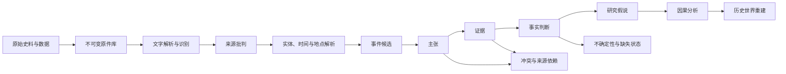
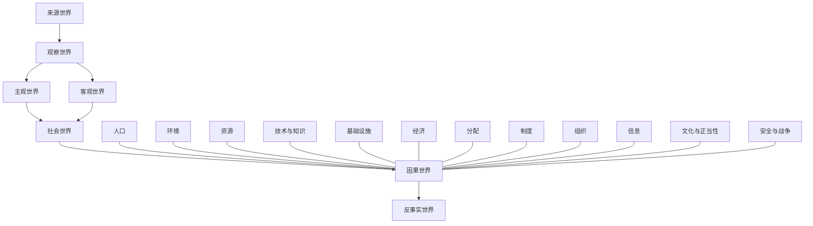

<div align="center">


# 史鉴

**面向严谨历史研究的证据、因果与世界重建系统**

[中文版](README.md) · [英文版](README_EN.md)

当前发布：**0.2.0 候选零版** · 发布裁决：**通过** · 裁决日期：**2026-10-11**

</div>

---

## 这是什么

史鉴不是一个“替你讲历史故事”的问答工具，而是一套把**原始史料、来源批判、主张、证据、事实判断、研究假说与因果分析**连接起来的研究系统。

它的核心目标是让任何重要结论都可以沿着证据链回到原始材料，并且把“知道”“推断”“争议”“缺失”明确区分开。

> **先有证据，再有结论；先保留不确定性，再谈解释。**

---

## 为什么做史鉴

传统历史研究中的困难往往不是“没有文本”，而是：

- 同一事件散落在不同史书、奏疏、地方志、档案和数据集中；
- 史料之间存在抄袭、转引、版本差异和来源依赖；
- “文献记载”不等于“客观事实”；
- 人口、军队、财政、灾害、粮价等数字常常口径不同；
- 研究者容易把观察、解释和因果判断混在一起；
- 复杂历史问题需要跨越政治、经济、人口、环境、技术、交通、组织和心理等多个维度。

史鉴把这些问题变成可以追踪、核验和复算的研究对象。

---

## 核心研究链



史鉴不会把这些层级压成一个“答案”。

```text
原始史料
→ 史料中的主张
→ 观察
→ 事实判断
→ 解释
→ 因果判断
→ 行为与心理解释
→ 受约束的反事实
```

---

## 关键原则

| 原则 | 含义 |
|---|---|
| 证据优先 | 重要结论必须能够回到来源与原始字节 |
| 不确定性优先 | 无法确认时明确保留争议、可能、未知或缺失 |
| 观察不等于解释 | 记录到的现象与研究者的解释分层保存 |
| 来源独立性很重要 | 多份互相抄录的材料不能被当成多份独立证据 |
| 当时语境优先 | 优先恢复历史参与者当时能知道什么、如何理解 |
| 没有证据不等于证伪 | 缺失、未记载、材料散佚与不可观察必须区分 |
| 模拟必须校准 | 任何重建与反事实都必须受到真实证据约束 |

---

## 历史世界模型

史鉴把历史研究拆成若干相互关联的世界层，并在同一个工作区中保持它们之间的边界。



其中技术、能源、材料、基础设施、人口、劳动力和迁移不是附属标签，而是历史世界中的一级驱动维度。

---

## 当前已经能做什么

### 一、建立真实史料库

- 导入文本、表格、扫描件与图像；
- 为原件计算摘要并保存来源信息；
- 原件进入后不可被后续识别结果覆盖；
- 派生数据可以重建，原始材料保持不变。

### 二、从史料建立可回证的研究对象

- 实体、别名、时间、地点与事件；
- 主张、证据、事实候选与冲突组；
- 来源关系与文本异文；
- 观察数据与代理指标；
- 研究问题与竞争性假说。

### 三、从结论回到原始材料

当前发布版已经实测贯通：


在有精确区域坐标时可以做区域级定位；没有精确区域坐标时只显示真实存在的页码、区块或字符区间，不会估算一个看似精确的位置。

### 四、研究问题与知识图

- 以研究问题为作用域加载知识图；
- 展示真实关系，不生成虚构的历史关系；
- 事实、证据、主张和来源可以互相跳转；
- 覆盖度与冲突状态可以在研究工作区中查看。

### 五、受控资料获取

系统已经具备资料获取工作流的基础能力：


它适合接入公开图书馆、档案馆、研究机构和开放数据来源。对于登录、付费、验证码、版权或其他访问限制，系统应明确标记阻断状态，而不是伪装成“已获取”。

它**不是一个可以绕过网站限制的通用网络爬取器**。

---

## 当前研究基准：晚明

首个参考时期固定为：

**1572—1644 年晚明**

核心实验窗口：

**1627—1644 年崇祯朝**

当前研究框架重点覆盖：

- 《明神宗实录》
- 《明光宗实录》
- 《明熹宗实录》
- 《崇祯长编》
- 《国榷》
- 《明季北略》
- 《明季南略》
- 《明史》
- 《大明会典》
- 地方志、奏疏、灾异材料
- 树轮、旱涝、人口、粮价、田赋、货币与其他结构化数据

发布时用于实测的研究工作区包含真实来源、主张、证据、事实候选、实体、观察和文字层；这些数据用于验证研究链是否真的可回证，而不是只验证空壳接口。

---

## 当前发布版的验证结果

本次发布不是按“页面能打开”来判定，而是按一组可复跑门禁裁决。

| 项目 | 结果 |
|---|---:|
| 发布级关键不变量 | 20 / 20 通过 |
| 全量后端测试 | 778 通过，0 失败，1 跳过 |
| 接口契约测试 | 73 项，0 失败 |
| 工作区安全检查 | 13 / 13 通过 |
| 隐私路由检查 | 9 / 9 通过 |
| 真实研究工作区浏览器走查 | 19 屏，0 失败 |
| 空工作区浏览器走查 | 12 屏通过，3 屏因无数据诚实跳过 |
| 独立审计推翻测试 | 17 / 17 被正确捕获 |
| 最终封板 | 18 / 18 通过 |
| 发布阻断项 | 0 |

正式裁决见：

- `histora-instrument/RC0_RELEASE_DECISION.md`
- `histora-instrument/RC0_RELEASE_MANIFEST.json`
- `histora-instrument/reports/rc0_final_seal.json`

---

## 桌面版

当前提供微软视窗系统目录版桌面程序。

发布裁决时封板的可执行文件：

```text
文件：desktop/dist/HCIS/HCIS.exe
大小：28,182,650 字节
摘要：4b21e8ddf5d9b681bda839b67530f508b9b731006b83a3014568a816d6b77e1b
```

桌面启动门已经实测：

- 独立工作区初始化；
- 动态端口；
- 同源前端与接口；
- 工作区身份保持；
- 退出后重新启动仍指向同一工作区；
- 不污染用户原有全局配置指针。

---

## 从源码启动

后端：

```bash
cd hcis/backend
python -m hcis.main
```

前端：

```bash
cd hcis/frontend
npm install
npm run dev
```

代码锁验证：

```bash
cd hcis
python scripts/verify_code_lock.py
python scripts/verify_bootstrap.py
```

完整发布证据与审计脚本位于：

```text
histora-instrument/
```

---

## 代码锁

史鉴把核心领域契约视为受保护层。

受保护内容包括领域模型、核心枚举、适配器契约、资料获取契约、接口契约、模式定义和验收测试等。

任何需要改变核心语义的修改都必须先提交契约变更提案，说明：

1. 为什么现有契约不能满足需求；
2. 哪些受保护文件会变化；
3. 数据迁移方案；
4. 向后兼容方案；
5. 测试方案；
6. 回滚方案。

这样做的目的，是防止实现代理为了“方便开发”而悄悄改变历史研究的认识论边界。

---

## 已知边界

当前发布版明确**没有**声称以下能力已经完成：

### 桌面包不含完整扫描识别运行时

开发环境可以具备扫描识别能力，但封板桌面包没有打入完整识别和图像处理资源；桌面实例会诚实显示资源缺失，而不是显示可用。

### 历史地名没有可靠几何时不画点

当前真实库中的地名不自动获得坐标。没有可信历史地理数据时，系统只保留文本地名和来源，不会让模型猜一个位置。

### 物理全新电脑验证尚未测量

已经完成隔离环境模拟和目录外启动，但没有把“开发机上的干净环境”冒充成“全新物理电脑”。

### 高阶研究层仍在后续版本

更完整的因果识别、反事实、认知与决策层、高级研究运行对比、历史世界模型和更深的覆盖来源追踪仍在后续版本继续推进。

详见：

- `histora-instrument/KNOWN_LIMITATIONS_RC0.md`
- `histora-instrument/RC1_BACKLOG.md`
- `histora-instrument/RC1_BACKLOG_ADDENDA.md`

---

## 项目目录

```text
bootstrap20/          初始代码锁基线
hcis/                 当前核心应用源码
histora-instrument/   测量、验收、审计与发布证据
histora-design/       设计探索与界面研究材料
desktop/              桌面打包与发布清单
reports/              部分历史报告
```

设计探索目录中的早期界面图可能包含模拟数据或旧状态，仅用于设计过程记录；**不能作为当前发布状态的证据**。

---

## 适合谁

史鉴面向需要处理复杂史料与长期证据链的研究者和个人研究项目，尤其适合：

- 历史学与历史社会科学研究；
- 多来源史料交叉核验；
- 长时段因果问题；
- 历史气候、人口、财政、战争和技术研究；
- 需要让人工智能输出能够回到原始证据的研究流程。

---

## 当前状态

**候选零版已经可以用于真实研究。**

下一阶段的重点不再是证明“系统能不能运行”，而是用更大规模、更复杂、更相互冲突的真实史料继续压测，并逐步推进历史地理、资料获取、高级因果分析和历史世界模型。

---

## 许可证与引用

仓库中包含多个外部组件、研究方法与数据来源的适配接口。使用或再分发前，请分别检查对应组件和数据集的许可证、版权与使用条款。

如果用于研究，请在成果中保留对原始史料、数据来源和具体版本的引用。史鉴本身不会替代这些原始来源。
