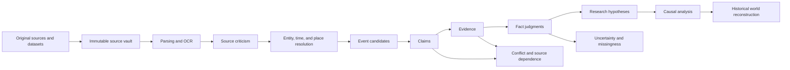
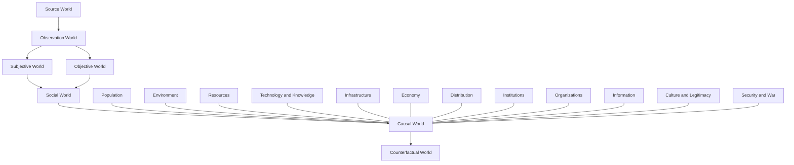

<div align="center">


# Histora

**An evidence-first system for historical research, causal analysis, and historical world reconstruction**

[Chinese](README.md) · [English](README_EN.md)

Current release: **0.2.0 RC0** · Release decision: **PASS** · Decision date: **2026-10-11**

</div>

---

## What is Histora?

Histora is not a generic system for producing historical narratives. It is a research system that connects **primary sources, source criticism, claims, evidence, fact judgments, research hypotheses, and causal analysis** while preserving provenance and uncertainty.

Its central requirement is simple: an important conclusion should be traceable back to the original source material.

> **Evidence first. Uncertainty first. Interpretation must not overwrite observation.**

---

## Why Histora exists

Historical research often involves more than finding text:

- the same event is scattered across chronicles, memorials, gazetteers, archives, and datasets;
- sources copy, quote, and depend on one another;
- a source claim is not automatically a historical fact;
- demographic, military, fiscal, disaster, and price records often use incompatible definitions;
- observations, interpretations, and causal judgments are easily conflated;
- major historical questions span institutions, economy, demography, environment, technology, infrastructure, information, organizations, and behavior.

Histora turns these problems into explicit, inspectable, and reproducible research objects.

---

## Core research chain



Histora preserves the epistemic ladder instead of collapsing it into one answer:

```text
Raw Source
→ Source Claim
→ Observation
→ Fact Judgment
→ Interpretation
→ Causal Judgment
→ Behavioral / Psychological Explanation
→ Constrained Counterfactual
```

---

## Core principles

| Principle | Meaning |
|---|---|
| Evidence First | Important conclusions must trace back to provenance and original bytes |
| Uncertainty First | Disputed, possible, unsupported, or unknown states stay explicit |
| Observation ≠ Interpretation | Recorded observations and researcher interpretation are stored separately |
| Source Independence Matters | Copied sources do not count as independent confirmation |
| Contemporary Meaning First | Reconstruct what historical actors could know and understand at the time |
| Absence of Evidence ≠ Evidence of Absence | Missing, unrecorded, lost, and unobservable states are distinguished |
| Simulation Must Be Calibrated | Reconstruction and counterfactuals remain constrained by evidence |

---

## Historical world model



Technology, energy, material systems, infrastructure, demography, labor, and migration are treated as first-class historical drivers rather than optional tags.

---

## What RC0 can already do

### Build a real source corpus

- ingest text, tables, scans, and images;
- preserve source metadata and content hashes;
- keep original source bytes immutable;
- rebuild derived data without overwriting source material.

### Build traceable research objects

- entities, aliases, times, places, and events;
- claims, evidence, fact candidates, and conflict groups;
- source relations and textual variants;
- observations and proxy interpretations;
- research questions and competing hypotheses.

### Trace conclusions back to source bytes

The release has been measured end-to-end across the following chain:


When real bounding boxes exist, the reader can use them. When they do not exist, the system reports the actual locator granularity instead of fabricating pixel precision.

### Research-scoped knowledge graph

- graph loading can be scoped by research question;
- historical relations come from real persisted relations rather than synthesized links;
- fact, evidence, claim, and source objects can be followed across the UI;
- coverage and conflict state are available in the research workspace.

### Controlled acquisition workflow


This workflow is designed for public libraries, archives, research institutions, and open datasets. Authentication, paywalls, captchas, copyright restrictions, and other access controls are not bypassed.

Histora is **not** a general-purpose unrestricted web crawler.

---

## Reference era: Late Ming

The first fixed reference era is:

**Late Ming, 1572–1644**

Core experimental window:

**Chongzhen reign, 1627–1644**

The research baseline includes materials such as:

- Veritable Records of the Wanli, Taichang, and Tianqi reigns;
- Chongzhen Changbian;
- Guoque;
- Mingji Beilüe and Mingji Nanlüe;
- Mingshi;
- Da Ming Huidian;
- local gazetteers, memorials, and disaster records;
- tree-ring, drought/flood, demographic, grain-price, taxation, monetary, and other structured datasets.

---

## Release verification

RC0 was closed by reproducible release gates rather than by a visual “it opens” check.

| Gate | Result |
|---|---:|
| Release-critical invariants | 20 / 20 PASS |
| Full backend test suite | 778 passed, 0 failed, 1 skipped |
| API contract tests | 73 cases, 0 failed |
| Workspace safety | 13 / 13 PASS |
| Privacy routing | 9 / 9 PASS |
| Real-workspace browser sweep | 19 screens, 0 failed |
| Empty-workspace browser sweep | 12 screens passed, 3 honestly skipped for no data |
| Independent audit attacks | 17 / 17 correctly detected |
| Final release seal | 18 / 18 PASS |
| RC0 blockers | 0 |

Authoritative release records:

- `histora-instrument/RC0_RELEASE_DECISION.md`
- `histora-instrument/RC0_RELEASE_MANIFEST.json`
- `histora-instrument/reports/rc0_final_seal.json`

---

## Desktop build

The sealed RC0 Windows desktop artifact was measured as:

```text
Path: desktop/dist/HCIS/HCIS.exe
Size: 28,182,650 bytes
SHA-256: 4b21e8ddf5d9b681bda839b67530f508b9b731006b83a3014568a816d6b77e1b
```

The desktop launch gate verifies isolated workspace initialization, dynamic ports, same-origin frontend/API delivery, persistent workspace identity across restart, and protection against mutating the user's existing global pointer.

---

## Run from source

Backend:

```bash
cd hcis/backend
python -m hcis.main
```

Frontend:

```bash
cd hcis/frontend
npm install
npm run dev
```

Verify the locked contract baseline:

```bash
cd hcis
python scripts/verify_code_lock.py
python scripts/verify_bootstrap.py
```

Release evidence and audit tooling live under:

```text
histora-instrument/
```

---

## Code Lock

Histora treats core epistemic and domain contracts as protected interfaces.

Changing a Level-A contract requires an explicit contract-change proposal covering:

1. why the existing contract is insufficient;
2. which locked files change;
3. migration impact;
4. backward compatibility;
5. test coverage;
6. rollback strategy.

This prevents implementation agents from silently changing the research model merely to simplify engineering work.

---

## Known boundaries

RC0 explicitly does **not** claim that the following are complete:

### OCR runtime is not bundled in the sealed desktop build

OCR can be available in the development checkout, but the sealed desktop package does not include the complete OCR/computer-vision runtime. The packaged instance reports missing resources instead of pretending that OCR is ready.

### Historical geography is not guessed

When trusted historical geometry is unavailable, Histora preserves place names and provenance without inventing coordinates.

### Physical clean-machine validation remains unmeasured

The release passed clean-environment simulation and out-of-project launch checks, but that is not reported as a test on a physically fresh Windows machine.

### Higher-order research layers continue in later releases

More complete causal identification, counterfactuals, cognition/decision modeling, advanced research-run diffs, deeper provenance for coverage calculations, and the broader historical world model remain active follow-up work.

See:

- `histora-instrument/KNOWN_LIMITATIONS_RC0.md`
- `histora-instrument/RC1_BACKLOG.md`
- `histora-instrument/RC1_BACKLOG_ADDENDA.md`

---

## Repository layout

```text
bootstrap20/          initial code-lock baseline
hcis/                 current application source
histora-instrument/   measurement, release, and audit evidence
histora-design/       design exploration material
desktop/              desktop packaging and release manifests
reports/              historical reports
```

Some early design material contains mock data or old release states. It is retained as design history and must not be interpreted as current release evidence.

---

## Who it is for

Histora is intended for researchers and long-running personal research projects that need explicit provenance and evidence structure, especially for:

- historical and historical-social-science research;
- multi-source corroboration and contradiction analysis;
- long-horizon causal questions;
- climate, demography, fiscal history, war, technology, and infrastructure research;
- AI-assisted research where outputs must remain traceable to primary evidence.

---

## Current status

**RC0 is usable for real research.**

The next stage is no longer to prove that the application can run. The focus moves to larger and more adversarial real corpora, stronger historical geography, broader acquisition coverage, advanced causal methods, and the historical world model.

---

## Licensing and citation

The repository integrates or interfaces with multiple third-party libraries, research methods, and external datasets. Check the applicable licenses and terms before redistribution or publication.

Research outputs should continue to cite the original historical sources, datasets, and editions. Histora does not replace those sources.
